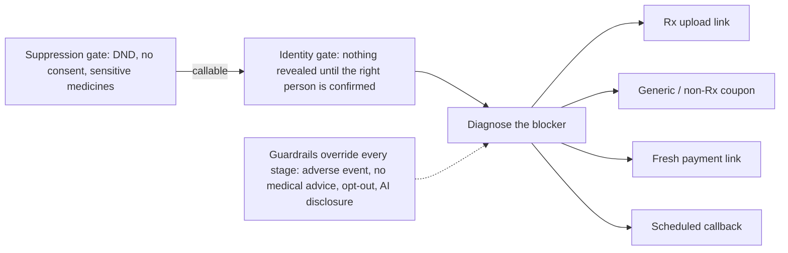

# Pharma Cart Recovery Voice Agent

**A voice agent that calls customers who abandoned an online-pharmacy cart, finds out what
actually stopped them, and fixes that one thing.**

## The problem I saw

The standard e-commerce win-back is "remind them and offer a discount". For medicine that's
the wrong playbook. People rarely abandon a medicine cart over price. They get stuck uploading
a prescription, their payment fails, or it isn't the right time. And prescription drugs
can't legally be discounted in the first place.

| Blocker | What actually resolves it | Discount helps? |
|---|---|---|
| Prescription friction | Upload link, teleconsult, pharmacist callback | No |
| Price objection | Generic substitute; coupon on non-Rx items only | Sometimes |
| Payment failure | Fresh payment link | No |
| Not now | Scheduled callback, refill reminder | No |
| Already bought elsewhere | Close gracefully, suppress | No |
| Trust doubts | Sourcing and expiry assurance | No |

## What I built

A **blocker-diagnosis agent, not a sales agent**:



- **The rule that matters most is enforced in code, not in the prompt.** `/coupon/apply`
  computes the non-prescription subtotal itself. It refuses Rx-only carts and applies only
  partially on mixed carts, naming the excluded items.
- **Safety beats the sale.** If a customer reports a side effect mid-call, the sale stops and an
  adverse-event record is filed. Medical advice is refused, and a pharmacist callback is offered.
- **Tested against 13 scenarios.** These include wrong person answers, indirect medical-advice
  questions, opt-out and silence. Testing surfaced 8 defects, almost all about turn-taking
  (when to speak, wait or hang up). All 8 were fixed.

This repo holds the mock pharmacy API the agent's tools call (8 endpoints, 3 seeded carts, one
per coupon/suppression behaviour) and the full design write-up:
**[docs/DESIGN.md](docs/DESIGN.md)**.

## Run the mock API

```sh
python -m venv .venv && source .venv/bin/activate
pip install -r requirements.txt
flask --app app run --port 5000
```

| Endpoint | Purpose |
|---|---|
| `GET /cart/<id>` | Cart, customer and call eligibility (pre-call) |
| `POST /rx/assist` | Send a prescription upload link |
| `POST /coupon/apply` | Apply a coupon to non-prescription items only |
| `POST /payment/link` | Send a fresh payment link |
| `POST /callback/schedule` | Book a callback |
| `POST /call/outcome` | Record the diagnosed blocker and result (post-call) |
| `POST /compliance/adverse-event` | File an adverse-event report |
| `GET /log` | Every request the agent made, for checking tool use |

## How I'd measure it in production

Track recovered-cart rate and cost per recovered cart, paired with guardrails that have hard
floors:
- zero Rx-discount violations,
- 100% adverse-event escalation,
- 100% of opt-outs honoured,
- zero disclosures before identity is verified.

I'd accept a lower recovery rate to keep all four at their floors.
